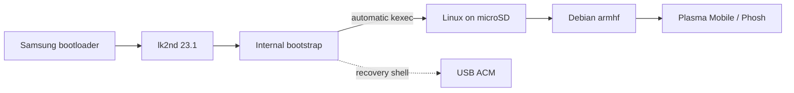

<p align="center">
  
</p>

<p align="center">
  
  
  
  
</p>

# Galaxy Tab 4 SM-T531 · Mainline Linux

**Native ARMv7 Linux** on the Samsung Galaxy Tab 4 10.1 **SM-T531** (`matisse3g`): Qualcomm **MSM8226**, four Cortex-A7 cores, and **Adreno 305B**. Debian armhf runs from **microSD**, independently of Android userspace.

> [!WARNING]
> **Tested hardware: SM-T531, r02 board variant** (Android DT: `[MATISSE-3G-OPEN] Rev-02-MTP-v2`). **r00/r01 compatibility is unverified.** Android reports `hw_rev=3`; this hardware revision number is distinct from the `r02` DT designation.

> [!IMPORTANT]
> **Experimental port — not a daily-driver image.** Real hardware works, but graphics stability, power management, and long-duration reliability are not fully accepted. **Do not flash a different Galaxy Tab 4 variant.**

## At a glance

| | Verified on the actual SM-T531 | Still limited / pending |
|:--:|---|---|
| 🟢 **Boot & Debian** | Internal bootstrap → SD kexec → Debian; USB ACM and Wi-Fi SSH | Extended cold-boot / endurance tests |
| 🟢 **CPU** | Seven stock frequency steps; all four cores; CPU hotplug; WFI and standalone collapse | Sustained thermal tests, deeper cluster idle |
| 🟢 **Storage & input** | microSD ext4 readback; touchscreen | SD hotplug and extended stress |
| 🟡 **Display** | Native MDP5 / DSI / TC358764 output; earlier physical image/touch acceptance | Historical black/frozen GUI reports; repeat physical and endurance acceptance of the current build |
| 🟢 **Backlight** | Phosh absent-sensor bug fixed; actual GUI/register range reaches 255 instead of 37 | Optical brightness acceptance and full panel power sequencing |
| 🟡 **GPU & shell** | Freedreno / Adreno acceleration; Plasma Mobile and native Phosh | Composition performance, fault recovery; [single qualified stack](docs/GRAPHICS-STACK.md) |
| 🟡 **Suspend** | Six CPU/L2 modes plus the power-key input path passed short checks; MDP5/OCMEM restore; [qualification](Porting%20Notes/interconnect.md), [mode selection](Porting%20Notes/power-management.md) | Fully clock-gated RPM collapse, XO/VMIN and long-term reliability remain open. No autonomy tests performed |
| 🟡 **Battery** | PM8226 BMS voltage/current/temperature/coulombs and modeled SOC | Capacity / aging / full-cycle accuracy |
| 🟡 **Wi-Fi** | Managed, WPA2 AP, raw standalone monitor + probe/data injection | [Tested scope](Porting%20Notes/wifi.md); firmware restart, PMF and RF-control limitations |
| 🟡 **Bluetooth** | Native WCN3660 controller, discovery/pairing and BLE mouse | Audio/data profiles, Classic and sleep acceptance pending |
| ⚪ **Built-in audio** | WCD9306/SLIMbus confirmed under Android | Native ADSP/ALSA card not brought up |
| ⚪ **Modem / cameras** | — | Not brought up / untested |

> [!NOTE]
> **Observed ≠ production-ready.** The status above summarizes on-device tests, not successful compilation alone. See [graphics stability](Porting%20Notes/mdp5.md), [battery evidence](Porting%20Notes/battery.md), and [patch review](docs/PATCH-REVIEW.md).

Hardware facts, graphics, sleep and peripheral integration are consolidated in
[Porting Notes](Porting%20Notes/README.md). The
[machine-readable task snapshot](status/hardware.yaml) records porting dependencies.

## Boot flow



> [!WARNING]
> The **internal BOOT / lk2nd chain is deliberately frozen**. Ordinary kernel updates target the SD card, **not internal partitions**. Verify your device identity, card mount points and backups before deployment. Read [Recovery & safety](docs/RECOVERY.md).

## Hardware reference and private backups

[Porting Notes](Porting%20Notes/README.md) contains component facts and Linux
integration. [Partition geometry](hardware/partitions.json) is retained as a
machine-readable backup/restore input; [docs](docs/README.md) contains procedures.
Raw dumps, calibration and device identities remain local. Use `./scripts/backup-stock --help` and the
[backup guide](docs/BACKUP-STOCK.md) for acquisition, integrity checks and
explicit restore plans. Default captures are stored in ignored `backup_stock/`.

## Build

Run `make check` for host-only source and documentation checks.
See the [documentation map](docs/README.md) and [tool index](tools/README.md)
for current guides, historical evidence and diagnostic scope.

```bash
make build
ROOTFS_PROFILE=mobile make rootfs
```

Detailed prerequisites, mount layout, deployment options and recovery-safe commands: **[Build & deploy →](docs/BUILD-DEPLOY.md)**

`ROOTFS_PROFILE=mobile` prepares **Plasma Mobile**. The optional **Phosh** profile requires its separate [build/install and session-selection steps](docs/PHOSH.md); these two commands alone do not reproduce the current tablet setup.

<details>
<summary><strong>📌 Pinned inputs and provenance</strong></summary>

| Input | Pinned version / role |
|---|---|
| [Linux stable](https://git.kernel.org/pub/scm/linux/kernel/git/stable/linux.git/tag/?h=v7.2.9) | `v7.2.9` · `5fce161649b4` |
| [lk2nd](https://github.com/msm8916-mainline/lk2nd/releases/tag/23.1) | `23.1`, **unmodified** |
| [Debian snapshot](https://snapshot.debian.org/archive/debian/20261003T000000Z/) | Debian **13.7 / trixie / armhf**, 2026-10-03 |
| [Samsung downstream kernel](https://github.com/LineageOS/android_kernel_samsung_msm8226/tree/3fa1853ed5d6c3a8ef5a2fda9822705243bbc256) | Hardware research **only**; not imported wholesale |
| [matisse3g device config](https://github.com/matissewifi/android_device_samsung_matisse3g/tree/cf5a3b04f9598d6756113b79df64e91aa53868d9) | Hardware reference |

Linux patch files live in [`patches/linux/`](patches/linux); board and build configuration in [`config/`](config). The port currently applies **139 local kernel patches** to the pinned upstream base, including bring-up diagnostics and unmerged changes. Original licensing and authorship are retained. Original source pins were recorded on **2026-10-13**; later device results and upstream checks carry their own dates.

</details>

## Project map

| Contents | Location |
|---|---|
| Component facts, Linux integration and unresolved work | [Porting Notes/](Porting%20Notes/README.md) |
| Build, installation and recovery procedures | [docs/](docs/README.md) |
| Diagnostics and workload tools | [tools/](tools/README.md) |
| Partition geometry and source provenance | `hardware/partitions.json`, `docs/hardware-source-manifest.json` |

> [!CAUTION]
> This repository contains **no universal flashable image**. Commands and partition assumptions are specific to the owner's verified SM-T531 setup. Never commit device credentials, factory calibration, raw partition backups, or unsanitized logs.
