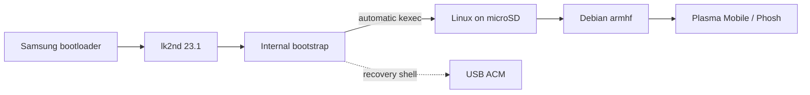

<p align="center">
  
</p>

<p align="center">
  
  
  
  
</p>

# Galaxy Tab 4 SM-T531 · Mainline Linux

**Native ARMv7 Linux** on the Samsung Galaxy Tab 4 10.1 **SM-T531** (`matisse3g`): Qualcomm **MSM8226**, four Cortex-A7 cores, and **Adreno 305B**. Debian armhf runs from **microSD**, independently of Android userspace.

> [!IMPORTANT]
> **Experimental port — not a daily-driver image.** Real hardware works, but graphics stability, power management, and long-duration reliability are not fully accepted. **Do not flash a different Galaxy Tab 4 variant.**

## At a glance

| | Verified on the actual SM-T531 | Still limited / pending |
|:--:|---|---|
| 🟢 **Boot & Debian** | Internal bootstrap → SD kexec → Debian; USB ACM and Wi-Fi SSH | Extended cold-boot / endurance tests |
| 🟢 **CPU** | Seven stock frequency steps; all four cores; CPU hotplug; WFI and standalone collapse | Sustained thermal tests, deeper cluster idle |
| 🟢 **Storage & input** | microSD ext4 readback; touchscreen | SD hotplug and extended stress |
| 🟡 **Display** | Native MDP5 / DSI / TC358764 output; earlier physical image/touch acceptance | Historical black/frozen GUI reports; repeat physical and endurance acceptance of the current build |
| 🟢 **Backlight** | Phosh absent-sensor bug fixed; actual GUI/register range reaches 255 instead of 37 | Optical brightness acceptance and full panel power sequencing |
| 🟡 **GPU & shell** | Freedreno / Adreno acceleration; Plasma Mobile and native Phosh | Composition performance, fault recovery; [single qualified stack](docs/GRAPHICS-STACK.md) |
| 🟡 **Suspend** | Six CPU/L2 modes plus the power-key input path passed short checks; MDP5/OCMEM restore; [qualification](docs/OCMEM-RESUME-20261103.md), [mode selection](docs/SLEEP-STACK.md) | Fully clock-gated RPM collapse, XO/VMIN and long-term reliability remain open. No autonomy tests performed |
| 🟡 **Battery** | PM8226 BMS voltage/current/temperature/coulombs and modeled SOC | Capacity / aging / full-cycle accuracy |
| 🟡 **Wi-Fi** | Managed, WPA2 AP, raw standalone monitor + probe/data injection | [Tested scope](docs/WIFI.md); firmware restart, PMF and RF-control limitations |
| 🟡 **Bluetooth** | Native WCN3660 controller, discovery/pairing and BLE mouse | Audio/data profiles, Classic and sleep acceptance pending |
| ⚪ **Built-in audio** | WCD9306/SLIMbus confirmed under Android | Native ADSP/ALSA card not brought up |
| ⚪ **Modem / cameras** | — | Not brought up / untested |

> [!NOTE]
> **Observed ≠ production-ready.** The status above summarizes on-device tests, not successful compilation alone. See [graphics stability](docs/GRAPHICS-STABILITY.md), [battery evidence](docs/BATTERY.md), and [patch review](docs/PATCH-REVIEW.md).

**Current graphics stack (2026-11-03):** unified Adreno 305 / MDP5 MSM
DRM, hardware Mesa 25.0.7 and Plasma Mobile with the restored quick-settings
cache. The single qualified stack measured **51.25 presentation events/s after
boot and 50.73/s after sleep**. The earlier approximately 35-FPS result used
the packaged plugin without this cache. These are DRM presentation counts,
not optical FPS; stable 60 FPS is not established. See the
[current stack and limitations](docs/GRAPHICS-STACK.md).

The mainline SD image booted and was persistently selected; six CPU/L2 sleep
modes and the power-key input path passed short checks, with final panels/input
confirmed before cache consolidation. The restored cache subsequently passed
s2idle/RPM checks. Long-term reliability, whole-SoC XO/VMIN sleep and GPU recovery
remain open; a GPU hang occurred during repeated live session restarts.

On **2026-10-22**, kernel #16 consolidates [WCN3660 support](docs/WIFI.md) into one kernel patch, selects software scanning without the known HAL208 timeout, clears stale scan state and excludes the unsupported channel 144 through standard OF limits. Managed, WPA2 AP, raw monitor, probe/data injection and hcxdumptool handshake capture passed short tests. Configuration/MSM module are unchanged; DTB adds only the frequency limit. Monitor is exclusive; firmware hot restart, PMF and advanced RF controls remain incomplete or unvalidated.

The **[full hardware matrix](docs/HARDWARE.md)** tracks 108 porting/acceptance tasks, with sources, remaining tests and [machine-readable dependencies](status/hardware.yaml). The [temporary Android cross-check](docs/ANDROID-HARDWARE-AUDIT.md) confirms several component identities; original internal BOOT was restored byte-for-byte. Android observations do not establish native Linux acceptance.

## Boot flow



> [!WARNING]
> The **internal BOOT / lk2nd chain is deliberately frozen**. Ordinary kernel updates target the SD card, **not internal partitions**. Verify your device identity, card mount points and backups before deployment. Read [Recovery & safety](docs/RECOVERY.md).

## Hardware reference and private backups

[`hardware/`](hardware/README.md) contains the component list and partition
geometry. Support status and research are in [docs](docs/README.md).
Raw dumps, calibration and device identities remain local. Use `./scripts/backup-stock --help` and the
[backup guide](docs/BACKUP-STOCK.md) for acquisition, integrity checks and
explicit restore plans. Default captures are stored in ignored `backup_stock/`.

## Build

Run `make check` for host-only source and documentation checks.
See the [documentation map](docs/README.md) and [tool index](tools/README.md)
for current guides, historical evidence and diagnostic scope.

```bash
make build
ROOTFS_PROFILE=mobile make rootfs
```

Detailed prerequisites, mount layout, deployment options and recovery-safe commands: **[Build & deploy →](docs/BUILD-DEPLOY.md)**

`ROOTFS_PROFILE=mobile` prepares **Plasma Mobile**. The optional **Phosh** profile requires its separate [build/install and session-selection steps](docs/PHOSH.md); these two commands alone do not reproduce the current tablet setup.

<details>
<summary><strong>📌 Pinned inputs and provenance</strong></summary>

| Input | Pinned version / role |
|---|---|
| [Linux stable](https://git.kernel.org/pub/scm/linux/kernel/git/stable/linux.git/tag/?h=v7.2.9) | `v7.2.9` · `5fce161649b4` |
| [lk2nd](https://github.com/msm8916-mainline/lk2nd/releases/tag/23.1) | `23.1`, **unmodified** |
| [Debian snapshot](https://snapshot.debian.org/archive/debian/20261003T000000Z/) | Debian **13.7 / trixie / armhf**, 2026-10-03 |
| [Samsung downstream kernel](https://github.com/LineageOS/android_kernel_samsung_msm8226/tree/3fa1853ed5d6c3a8ef5a2fda9822705243bbc256) | Hardware research **only**; not imported wholesale |
| [matisse3g device config](https://github.com/matissewifi/android_device_samsung_matisse3g/tree/cf5a3b04f9598d6756113b79df64e91aa53868d9) | Hardware reference |

Linux patch files live in [`patches/linux/`](patches/linux); board and build configuration in [`config/`](config). The port currently applies **139 local kernel patches** to the pinned upstream base, including bring-up diagnostics and unmerged changes. Original licensing and authorship are retained. Original source pins were recorded on **2026-10-13**; later device results and upstream checks carry their own dates.

</details>

## Research map

| Area | Start here |
|---|---|
| Hardware inventory / porting order | [Full functional matrix](docs/HARDWARE.md) · [Machine-readable tasks](status/hardware.yaml) |
| 🖥️ **Native screen / DSI / LVDS** | [Native KMS](docs/NATIVE-KMS.md) · [Graphics stability](docs/GRAPHICS-STABILITY.md) |
| 🎮 **Rendering performance** | [Graphics](docs/GRAPHICS.md) · [Bottlenecks](docs/GRAPHICS-BOTTLENECK.md) · [Memory bus](docs/MEMORY-BUS.md) |
| 📱 **Mobile shell** | [Phosh](docs/PHOSH.md) · [Backlight](docs/BACKLIGHT.md) |
| 🔋 **Battery & charging** | [Battery measurements](docs/BATTERY.md) |
| 🧪 **Patch acceptance** | [Patch review](docs/PATCH-REVIEW.md) · [Measured JSON datasets](docs) |
| 🛠️ **Operations** | [Build / deploy](docs/BUILD-DEPLOY.md) · [Recovery / safety](docs/RECOVERY.md) |

<details>
<summary><strong>Latest practical graphics constraints</strong></summary>

- Native scanout and GPU acceleration work, but the project explicitly records **missing / frozen GUI** reports.
- An ordinary Phosh drawer run was approximately **33 presentations/s**; a **59.993 presentations/s** fullscreen direct-scanout test does **not** mean the composited desktop runs at 60 FPS.
- Firmware-owned bridge power, GPU runtime workarounds, and resume/recovery paths remain bring-up topics.
- Some logs, calibration, firmware and device-identifying records are intentionally kept **outside Git**.

The evidence and caveats are in [Graphics stability](docs/GRAPHICS-STABILITY.md), [Patch review](docs/PATCH-REVIEW.md), and [Native KMS](docs/NATIVE-KMS.md).

</details>

> [!CAUTION]
> This repository contains **no universal flashable image**. Commands and partition assumptions are specific to the owner's verified SM-T531 setup. Never commit device credentials, factory calibration, raw partition backups, or unsanitized logs.
