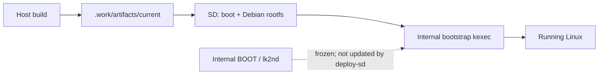

# Build & deployment

> [!IMPORTANT]
> **Device-specific bring-up procedure.** Confirm the tablet is **SM-T531 / matisse3g** and positively identify **both** SD mounts before writing. No part of this guide authorizes flashing internal Android partitions.

## Requirements

| Group | Tools |
|---|---|
| Base | Git, Make, GCC, Python 3, curl, sudo, ripgrep (`rg`), `dpkg-deb` |
| Cross-build | `gcc-arm-linux-gnueabihf`, binutils, bison, flex, `libssl-dev`, `libelf-dev`, `bc`, `dtc` |
| Images / rootfs | `cpio`, `gzip`, `e2fsprogs`, `mkbootimg`, `debootstrap`, Debian archive keyring |
| ARM packages | Static QEMU ARM + binfmt; `qemu-arm` must execute **armhf** binaries |

## Host build

```bash
make build
ROOTFS_PROFILE=mobile make rootfs
```

- `make build`: pinned Linux **v7.2.9**, ordered patches, board config, modules, DTB, boot container and checksums.
- `ROOTFS_PROFILE=mobile`: Debian armhf with **Plasma Mobile**, SDDM, the native Mesa entry and activation service. Phosh requires the separate [Phosh build/install workflow](PHOSH.md).
- Outputs: `.work/artifacts/current/`; kernel source: `.work/linux/`; build output: `.work/out/`.
- Default kernel build uses **native MDP5 / DSI + interconnect** (`NATIVE_KMS=1`, `NATIVE_ICC=1`).
- Older firmware-framebuffer recovery build: `make build` — **different graphics path**, not a drop-in guarantee.

Run these commands from the repository root, in order. `rootfs.sh` copies the module tree from `.work/artifacts/current/modules/` **if it exists**; build the matching kernel first. A fresh rootfs does not automatically reproduce the tablet's manually deployed Phosh runtime, device-local GPU power hold or private Wi-Fi configuration. WCNSS also needs the device firmware/calibration at the DT paths `qcom/matisse3g/wcnss.mdt` and `qcom/matisse3g/WCNSS_qcom_wlan_nv.bin`; the script does not import the owner's private copies.

> [!NOTE]
> The artifact named `zImage` on the **internal-bootstrap SD path** is an Android-v0 `sd-kernel.img` *container* with an appended DT. The host's separate `zImage` build artifact is the real Linux kernel. Do not interchange these blindly.

## Deploy to the SD card

The verified card layout uses a **48 MiB ext2** boot partition (`T531_BOOT`) and **ext4** root partition (`T531_ROOT`). The mount paths below are **placeholders**. Rootfs extraction is for a **fresh root partition**; do not use it as an in-place update over the installed system.

```bash
# Only after verifying the correct card, mounts, and filesystems:
make deploy-sd BOOT_MODE=internal BOOT_MOUNT=/mounted/card-boot

# Extract Debian onto the verified, mounted ext4 ROOT partition:
sudo tar --numeric-owner -xpf .work/artifacts/current/debian-armhf.tar.gz \
  -C /mounted/card-root
```

| Mode | What it means |
|---|---|
| `BOOT_MODE=internal` | Frozen internal bootstrap kexecs the SD kernel. Keep SD `/extlinux/extlinux.conf` **absent**. |
| `BOOT_MODE=sd` | Standalone SD boot with its extlinux entry. Use only when deliberately selecting this path. |

The deploy script requires a mounted **ext2** boot root and rejects an existing extlinux entry to avoid unsafe overwrites. It **does not** select or validate the physical card for you.

`deploy-sd` copies boot files only: it does not install the rootfs or a new module tree, create a rollback snapshot, or arrange an automatic fallback. For an existing rootfs, install the matching modules and native userspace setup as well. The shared release string `7.2.9-dirty` does not establish that two builds are compatible. The owner's most recent on-device updates use the hash-checked [kernel trial/rollback path](RECOVERY.md#graphics-fallback).

## What changes, what does not



- Kernel and rootfs updates use the SD path.
- Never treat `make bootstrap` as an ordinary SD-kernel update; it builds the **first stage** without flashing it.
- An existing Debian installation requires the matching native Mesa entry / activation setup before switching from simpledrm to native KMS; see [Native KMS](NATIVE-KMS.md).

## Reproducibility & secrets

- The build checks the pinned source commit and applied patch prefix; outputs include hash manifests.
- Build timestamp, build user/host, and input archives are pinned, but the rootfs is **not promised byte-for-byte reproducible**.
- A newly built image is not automatically byte-identical to the installed diagnostic `#8` image: configuration, build metadata and input state must also match its recorded artifact.
- Do not put Wi-Fi credentials, SSH keys, firmware, calibration, MAC addresses, raw DT dumps, or unsanitized logs into Git.

For troubleshooting or fallback steps, use **[Recovery & safety](RECOVERY.md)**.
