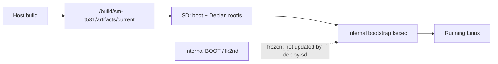

# Build & deployment

> [!IMPORTANT]
> **Device-specific bring-up procedure.** Confirm the tablet is **SM-T531 / matisse3g** and positively identify **both** SD mounts before writing. No part of this guide authorizes flashing internal Android partitions.

## Requirements

| Group | Tools |
|---|---|
| Base | Git, Make, GCC, Python 3, curl, sudo, ripgrep (`rg`), `dpkg-deb` |
| Cross-build | `gcc-arm-linux-gnueabihf`, binutils, bison, flex, `libssl-dev`, `libelf-dev`, `bc`, `dtc` |
| Images / rootfs | `cpio`, `gzip`, `e2fsprogs`, `mkbootimg`, `debootstrap`, Debian archive keyring |
| ARM packages | Static QEMU ARM + binfmt; `qemu-arm` must execute **armhf** binaries |

## Host build

```bash
make build
ROOTFS_PROFILE=mobile make rootfs
```

- `make build`: pinned Linux **v7.2.9**, ordered patches, board config, modules, DTB, boot container and checksums.
- `ROOTFS_PROFILE=mobile`: Debian armhf with **Plasma Mobile**, SDDM, the native Mesa entry and activation service. Phosh requires the separate [Phosh build/install workflow](PHOSH.md).
- Outputs: `../build/sm-t531/artifacts/current/`; kernel source: `../sources/linux-mainline/`; build output: `../build/sm-t531/out/`.
- Default kernel build uses **native MDP5 / DSI + interconnect** (`NATIVE_KMS=1`, `NATIVE_ICC=1`).

For a mobile rootfs, first build the DRM capability probes against an existing
armhf sysroot containing libdrm development files:

```bash
DRM_SYSROOT=/path/to/armhf-sysroot ./scripts/graphics/build-probe.sh
```

The generated probe is a required input to the mobile rootfs recipe.
Run the build/rootfs commands from the repository root, in order. `rootfs.sh` copies the module tree from `../build/sm-t531/artifacts/current/modules/` **if it exists**; build the matching kernel first. A fresh rootfs does not automatically reproduce the installed custom KWin/Qt/Mesa/Plasma stack or private Wi-Fi configuration; use the [graphics stack guide](GRAPHICS-STACK.md) for its exact component identities. WCNSS also needs the device firmware/calibration at the DT paths `qcom/matisse3g/wcnss.mdt` and `qcom/matisse3g/WCNSS_qcom_wlan_nv.bin`; the script does not import the owner's private copies.

> [!NOTE]
> The artifact named `zImage` on the **internal-bootstrap SD path** is an Android-v0 `sd-kernel.img` *container* with an appended DT. The host's separate `zImage` build artifact is the real Linux kernel. Do not interchange these blindly.

## Deploy to the SD card

The verified card layout uses a **48 MiB ext2** boot partition (`T531_BOOT`) and **ext4** root partition (`T531_ROOT`). The mount paths below are **placeholders**. Rootfs extraction is for a **fresh root partition**; do not use it as an in-place update over the installed system.

```bash
# Only after verifying the correct card, mounts, and filesystems:
make deploy-sd BOOT_MODE=internal BOOT_MOUNT=/mounted/card-boot

# Extract Debian onto the verified, mounted ext4 ROOT partition:
sudo tar --numeric-owner -xpf ../build/sm-t531/artifacts/current/debian-armhf.tar.gz \
  -C /mounted/card-root
```

| Mode | What it means |
|---|---|
| `BOOT_MODE=internal` | Frozen internal bootstrap kexecs the SD kernel. Keep SD `/extlinux/extlinux.conf` **absent**. |
| `BOOT_MODE=sd` | Standalone SD boot with its extlinux entry. Use only when deliberately selecting this path. |

The deploy script requires a mounted **ext2** boot root and rejects an existing extlinux entry to avoid unsafe overwrites. It **does not** select or validate the physical card for you.

`deploy-sd` copies boot files only: it does not install the rootfs or a new module tree, create a rollback snapshot, or arrange an automatic fallback. For an existing rootfs, install the matching modules and native userspace setup as well. Matching release strings alone do not establish that two builds are compatible. Existing-system graphics updates use the hash-checked [slot trial/rollback path](UNIFIED_DRM.md).

## What changes, what does not



- Kernel and rootfs updates use the SD path.
- Never treat `make bootstrap` as an ordinary SD-kernel update; it builds the **first stage** without flashing it.
- An existing Debian installation requires the matching native Mesa entry / activation setup before switching from simpledrm to native KMS; see [Native KMS](../Porting%20Notes/display.md).

## Reproducibility & secrets

- The build checks the pinned source commit and applied patch prefix; outputs include hash manifests.
- Build timestamp, build user/host, and input archives are pinned, but the rootfs is **not promised byte-for-byte reproducible**.
- A newly built image is not automatically byte-identical to the installed diagnostic `#8` image: configuration, build metadata and input state must also match its recorded artifact.
- Do not put Wi-Fi credentials, SSH keys, firmware, calibration, MAC addresses, raw DT dumps, or unsanitized logs into Git.

For troubleshooting or fallback steps, use **[Recovery & safety](RECOVERY.md)**.

## Host layout after the 2026-11-06 cleanup

Generated files live outside the repository, in `../build/sm-t531/` by default.
The main kernel source defaults to `../sources/linux-mainline/`; `KERNEL_SRC`,
`KERNEL_OUT`, `WORK_DIR`, `SOURCES_DIR` and `ARTIFACTS_DIR` override the build paths.
All host build/package/deploy helpers share `scripts/lib/host-paths.sh`.
Child scripts inherit the selected paths. Bootstrap builds use separate defaults:
`../sources/linux-bootstrap/`, `../build/sm-t531/bootstrap/out/` and
`../build/sm-t531/bootstrap/artifacts/`. Explicit overrides take precedence.
One retained installed build is in `../artifacts/mainline-20261103/`, with
`SHA256SUMS`. This archive is separate from the next build's output directory.
No build step depends on a retained `.work` directory. Historical paths in
research reports describe old experiments, not required current inputs.

Frozen bootstrap source/layout constraints are recorded in
[storage notes](../Porting%20Notes/storage.md#boot-chain). It is a separate build
profile and must not be flashed as part of ordinary main-kernel updates.
